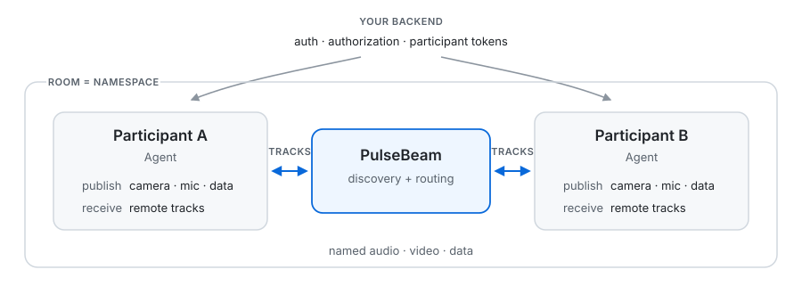

<h1> PulseBeam</h1>

**The open-source realtime stack for audio, video, and data.**  
**Built to stay out of your way.**

PulseBeam is a Rust media server and SDK stack for browser and native applications. Web and React SDKs are available today; native SDKs are in development.

Participants publish named audio, video, and data tracks into a room. Each participant can both send and receive tracks. We'd rather improve a default than add another knob.

[Get started](#local-development-demo) · [Documentation](https://docs.pulsebeam.dev) · [Meet example](https://github.com/PulseBeamDev/pulsebeam/tree/main/apps/meet) · [Discord](https://discord.com/invite/Bhd3t9afuB)

## The model

- **Room:** A namespace for discovering participants and tracks. It does not own your application's lifecycle.
- **Participant:** An identity in a room. It can represent a person, agent, device, or service.
- **Track:** Named audio, video, or application data published by a participant.
- **Agent:** The bidirectional SDK handle for one participant: publish local tracks, discover and receive remote tracks, send and receive data, and observe connection state.



Your backend owns authentication, authorization, application state, persistence, and APIs. PulseBeam owns the realtime path.

## Work with tracks

React today:

```tsx
const capture = useCapture("device", { video: true, audio: true })
const agent = useAgent({ endpoint, token })

const videos = agent.remote.participants.flatMap(({ tracks }) =>
  tracks.filter(
    (track): track is RemoteVideoTrack => track.kind === "video",
  ),
)

return (
  <>
    <button onClick={() => void capture.request()}>
      Enable camera & mic
    </button>
    <button onClick={() => agent.connect()}>
      Connect
    </button>

    <Publish track={agent.video("camera")} source={capture.video} />
    <Publish track={agent.audio("microphone")} source={capture.audio} />

    {videos.map((video) => (
      <Video
        key={`${video.participantId}:${video.label}`}
        source={video}
        style={{ width: 320, height: 240 }}
      />
    ))}

    <Audio agent={agent} />
  </>
)
```

`Publish` is a [renderless component](https://kyleshevlin.com/renderless-components/): mount it to own publication; capture stays independent.

### Video demand follows the UI

`Video` is more than playback. A visible, nonzero-sized video creates receive demand, and the runtime adapts what it requests as layout and bandwidth change.

Use `receive` when application intent matters:

```tsx
<Video
  source={video}
  receive={{
    priority: pinned ? 200 : 10,
    minFps: 15,
    playoutDelay: { minMs: 100, maxMs: 200 },
  }}
/>
```

So the default path follows the UI automatically, while pinned tiles, latency-sensitive views, or other application-specific cases can override policy.

### Data is a track, too

```tsx
const cursor = agent.data("cursor", "latest")
const reactions = agent.data("reactions", "lossy")
const messages = agent.data("messages", "ordered")
```

| Mode | Semantics |
| --- | --- |
| `latest` | Only the newest state matters |
| `lossy` | Missing events are not recovered |
| `ordered` | Preserve order with bounded recovery |

Payloads are bytes. `ordered` reports a gap when recovery history is no longer available. Data is live delivery, not durable storage.

[Data delivery and recovery](https://github.com/PulseBeamDev/pulsebeam/blob/main/docs/react/guides.md#data-tracks)

<a id="local-development-demo"></a>

## Local development demo

The source development setup currently targets Linux x86_64. Start from a checkout with the [host prerequisites](https://github.com/PulseBeamDev/pulsebeam/blob/main/docs/build.md#host-prerequisites).

Start the server:

```sh
./bazel run --config=dev //:server -- --dev
```

Start Meet:

```sh
./bazel run //:meet_dev -- --port 3000
```

Create two participant tokens:

```sh
./bazel run //:cli -- token \
  --room demo \
  --participant alice

./bazel run //:cli -- token \
  --room demo \
  --participant bob
```

Open `http://localhost:3000` in two tabs. Use a different token in each tab, set the server URL to `http://localhost:7070`, allow camera and microphone access, and join.

Each tab should discover the other participant. Select the remote video tile to view its camera. Mute both microphones to avoid feedback.

Development mode uses public credentials. Do not expose a `--dev` server to the internet. The local server uses TCP `7070` for signaling and TCP/UDP `3478` for WebRTC.

## How we test

We run the server and native SDK together in a [deterministic simulator](https://github.com/PulseBeamDev/pulsebeam/tree/main/crates/pulsebeam-simulator), using real signaling and media code over a controlled network. We check what arrives, whether video decodes, and whether clients recover after failures.

Virtual time lets us run many repeatable network scenarios, sometimes faster than real time. It does not reproduce every browser or operating system behavior, so we also test in browsers and against real network sockets.

The native SDK uses libwebrtc. The Web and native SDKs share the same Rust core for connection state and recovery, and the simulator exercises that core through the native SDK.

We also [check the checks](https://github.com/PulseBeamDev/pulsebeam/tree/main/crates/pulsebeam-simulator#calibrate-public-contract-detectors) by injecting faults and verifying that the test suite catches them. The [testing guide](https://github.com/PulseBeamDev/pulsebeam/blob/main/docs/build.md#client-qa-boundaries) explains the current QA boundaries.

## WebRTC

WebRTC is our transport today: boring, battle-tested.

PulseBeam keeps SDP, ICE candidates, transceivers, and renegotiation below the participant-and-track API.

## Where things stand

PulseBeam is under active development.

| Component | Status |
| --- | --- |
| Server | Self-hostable |
| Web SDK | Available |
| React SDK | Available |
| Native SDKs | In development, not yet published |
| Audio | Opus |
| Video | H.264 Baseline |
| Transport | WebRTC |

If something breaks or does not fit what you are building, [open an issue](https://github.com/PulseBeamDev/pulsebeam/issues) or [talk with us on Discord](https://discord.com/invite/Bhd3t9afuB).

<details>
<summary>Metrics and profiling</summary>

Prometheus metrics:

```text
http://localhost:6060/metrics
```

CPU profiles:

```text
http://localhost:6060/debug/pprof/profile?seconds=30
```

Keep port `6060` private.

</details>

[Build and development](https://github.com/PulseBeamDev/pulsebeam/blob/main/docs/build.md) · [Roadmap](https://github.com/orgs/PulseBeamDev/projects/2/views/4) · [Benchmark write-up](https://pulsebeam.dev/blog/moving-to-thread-per-core)

**License:** [Server: AGPL-3.0](https://github.com/PulseBeamDev/pulsebeam/blob/main/LICENSE) · [Client SDKs: Apache-2.0](https://github.com/PulseBeamDev/pulsebeam/blob/main/agents/pulsebeam-agent-web/LICENSE)
