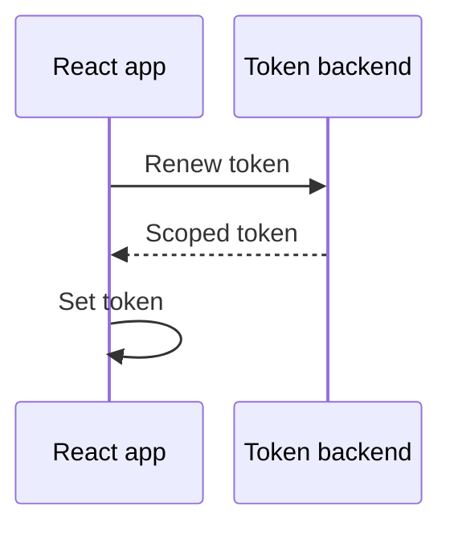

# Add one feature

Start from the [working room](/react/quickstart). Pick what you want to build.
All examples use `@pulsebeam/react`; `useAgent` supplies a handle from the first render.

| Build | Jump to |
| --- | --- |
| Camera preview before joining | [Preview](#pre-join-preview) |
| Camera/microphone picker | [Devices](#device-selection-and-replacement) |
| Mute and stop buttons | [Controls](#enablement-withdrawal-and-release) |
| Screen sharing | [Screen](#screen-sharing) |
| Participant videos | [Remote video](#remote-discovery-and-video-receive-policy) |
| Enable-audio button | [Audio](#remote-audio-and-autoplay) |
| Longer sessions | [Connection and tokens](#connection-renewal-and-errors) |
| Live messages | [Topics](#typed-topics) |

## Pre-join preview

1. Call `useUserMedia({video: true, audio: true})` in a mounted component.
2. From a click, call `capture.request()` and catch rejection.
3. Render `<Video source={capture.videoTrack} mirror />`.

**You see:** your camera, without connecting an Agent. On join, bind the sources
as in the quickstart. Keep the capture component mounted to keep its devices.
A captured-source preview ignores publication mute; a local-handle preview follows it.

## Device selection and replacement

1. Call `useMediaDevices()`; wait for `state === "ready"`.
2. Show `cameras` and `microphones`. Labels may be empty before permission.
3. Pass the chosen ID to `useUserMedia`, for example
   `{video: {deviceId: {exact: cameraId}}, audio: true}`.
4. After the first explicit request, option changes replace capture automatically.
   Keep the quickstart's source-binding effect.

**You see:** the new camera after success. Until then, the old capture stays.
On failure it can remain `active` with an `error`; offer another device or relax
the constraint. Do not clear a working preview. Check enumeration errors too.
`speakers` is a list, not a speaker-selection API.

## Enablement, withdrawal, and release

Use stable handles such as `agent.local.video("camera")`.

| Button | Action | What changes |
| --- | --- | --- |
| Mute | `handle.setEnabled(false)` | Black video/silent audio; capture and publication remain |
| Unmute | `handle.setEnabled(true)` | Current source sends again |
| Stop publishing | `handle.setSource(null)` | Publication disappears; capture remains |
| Release devices | `capture.stop()` and update/clear bound sources | Devices stop |
| Leave | `agent.disconnect()` and `capture.stop()` | Session and devices stop |

A label keeps its slot even after withdrawal; enablement survives source changes.
Catch `LocalTrackCapacityError` if allocating labels can exceed your topology.
Do not clear handles in an effect cleanup after their Agent has closed.

## Screen sharing

1. Add `useDisplayMedia({video: true, audio: false})`.
2. Call `share.request()` directly from a **Share screen** click; catch rejection.
3. Bind `share.videoTrack` to `agent.local.video("screen")`; preview without mirroring.
4. To stop, call `share.stop()` and clear the publication.

**You see:** a separate screen video. The default reserves two local video slots, enough
for one camera and one screen publication. Additional video labels require
explicit capacity. Browser **Stop sharing** also
ends capture. Changing options never opens the chooser automatically.
Display audio depends on the browser and selected surface, even with `audio: true`.

## Remote discovery and video receive policy

1. Read `agent.remote.videoTracks`; collections exclude yourself.
2. Render visible, nonzero-size `<Video source={track} />` elements.
3. Key them by external `participantId` plus `label`, not publication ID.

**You see:** moving video. Visible size in physical pixels drives receive demand;
hiding or unmounting releases it. Multiple views share the maximum size.
`autoPlay={false}` still requests video; use native controls to start playback.

For tuning, call
`track.setReceiveOptions({minHeight: 180, minFps: 15, priority: 100})`.
Policy alone does not request hidden video. Excess views beyond `remoteVideos`
stay unassigned and warn. The default is 16 remote video slots; set a custom
topology before connection if you need more. Changing it recreates the Agent;
automatic capacity growth is not supported yet.

Known participant? `agent.remote.participant("alice").video("camera")` works
before discovery and survives republication. [Exact policies](/react/reference#remote-media).

## Remote audio and autoplay

Remote audio plays automatically; no audio component is needed.

1. Show an **Enable audio** button when playback is blocked.
2. Call `agent.remote.resumeAudio()` directly in its click handler.
3. Catch and display rejection; do not retry with a timer.

**You hear:** the other participant. A track's `receiving` means receiver assignment,
not audible sound. For video, store `onPlaybackError`'s supplied `retry` and invoke
it from a button instead. [Playback diagnostics](/react/troubleshooting#autoplay).

## Connection, renewal, and errors

Show `agent.connection` and `agent.error`, not just the last button clicked.
The runtime retries temporary loss while connection is desired. `reconnect()`
retains desired media/topic state; `disconnect()` stops retries, not capture.
Fix a `terminal-failure` before creating a fresh Agent.

### Renew before expiry

Your backend issues the next token for the **same room and participant**.



Fetch before `agent.authorizationExpiresAt` (Unix seconds), then update only
`config.token`. The hook renews the same Agent; changing endpoint or topology replaces it; logging changes update in place.
Caller-owned Agents use `renewAuthorization(token)`.
The SDK does not fetch tokens. Keep keys server-side, report renewal failures,
and use a new Agent to change room or participant.

Catch capture, playback, and topic failures at their controls. In React, read
`agent.error` directly; `useAgent` owns the subscription and rerenders the component.
Use `subscribeEvents` only when you specifically need the diagnostic/event stream.
[Choose the next diagnostic](/react/troubleshooting).

## Typed topics

Send live JSON messages, not durable chat history.

The fragment below goes inside your component. Import `useEffect` from `react`;
`agent` is hook-owned. `setMessages` updates a string array and `reportError`
displays a failure; their UI definitions are omitted.

```tsx
useEffect(() => {
  if (!agent) return;
  const controller = new AbortController();
  const chat = agent.topic<{ text: string }>("chat", { mode: "reliable" });
  void (async () => {
    for await (const message of chat.subscribe({ signal: controller.signal })) {
      setMessages((previous) => [...previous, message.text]);
    }
  })().catch(reportError);
  return () => controller.abort();
}, [agent]);
```

In your send handler, get the same `chat` facade and call
`void chat.publish({text: "hello"}).catch(reportError)`.

**You receive:** live messages while subscribed. Creating the facade alone does
not subscribe; aborting or ending iteration releases the subscription.

| Mode | Use |
| --- | --- |
| `reliable` | Ordered messages; bounded queue |
| `unreliable` | Latest values; new messages can replace queued ones |

Neither mode promises offline replay or exactly-once delivery. Recovery can lose
messages; reload backend state when gaps matter. JSON above 65,536 bytes rejects;
the generic type does not validate untrusted data or authorize users.
[Queue limits and diagnostics](/react/reference#topics).
