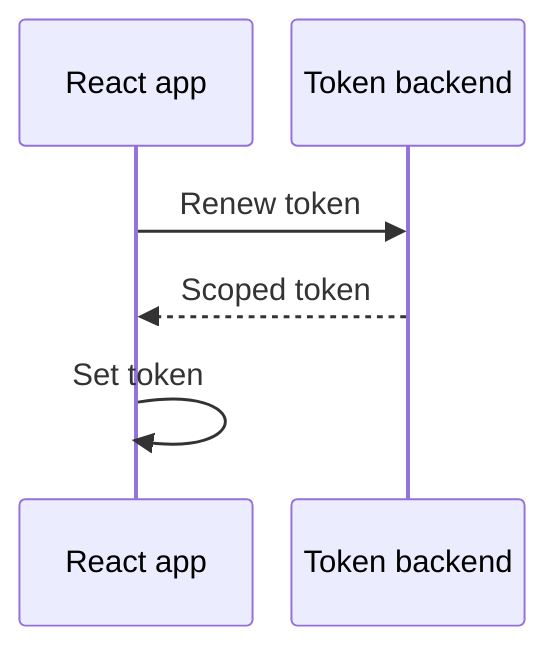

# Integration guides

Start with the working [quickstart](/react/quickstart), then add one task at
a time. These guides use a React-owned Agent from `useAgent`; check for null
before accessing it. See the [reference](/react/reference) for exact types.

| Task | Start here |
| --- | --- |
| Let people check their camera before joining | [Pre-join preview](#pre-join-preview) |
| Choose another camera or microphone | [Device selection](#device-selection-and-replacement) |
| Mute, stop sharing, or release devices | [Media controls](#enablement-withdrawal-and-release) |
| Share a screen | [Screen sharing](#screen-sharing) |
| Show participants and tune video | [Remote video](#remote-discovery-and-video-receive-policy) |
| Recover blocked sound | [Remote audio](#remote-audio-and-autoplay) |
| Renew a token or handle connection errors | [Connection and renewal](#connection-renewal-and-errors) |
| Send app messages | [Typed topics](#typed-topics) |

## Pre-join preview

Let people check their devices without joining a room.

1. In a mounted component, call `useUserMedia({video: true, audio: true})`.
2. From a click handler, call `capture.request()` and catch its rejection.
3. Render `<Video source={capture.videoTrack} mirror />`.
4. On join, lend the sources to the Agent's local handles with `setSource`,
   as the quickstart does.

No Agent is needed for the preview. The capture hook owns the device tracks;
a local handle only borrows a source. Keep the capture component mounted if
you want that same capture to survive the transition into the room.

**Check:** the local preview appears while disconnected. Unmounting the capture
component stops the devices.

A captured-source preview still shows the camera when a publication is disabled.
Use `<Video source={cameraHandle} />` if the preview should blank when you call
`cameraHandle.setEnabled(false)`.

## Device selection and replacement

1. Call `useMediaDevices()`. Check its `state` and `error` before showing choices.
2. Read `cameras` and `microphones`. Each device has an `id` and `label`;
   browser privacy may leave them empty until permission is granted.
3. Pass the chosen ID to `useUserMedia`, for example
   `{video: {deviceId: {exact: cameraId}}, audio: true}`.
4. Request capture once from a user action. Later option changes request replacement.
5. Keep the quickstart's effect that binds source changes to the local handles.

| Replacement result | What to show |
| --- | --- |
| Pending | The old capture remains available |
| Success | New capture becomes active; old native tracks stop |
| Failure with `state === "active"` | Keep the old preview and show `error` |

If an exact device constraint fails, let the user choose another device or
relax the constraint. Do not hide a working preview just because replacement failed.

The binding effect needs no teardown: new sources replace old ones, stopped
capture changes to null, and `useAgent` closes its handles on unmount.
Do not call `setSource` in cleanup after its Agent has closed.

**Limit:** `speakers` lists devices, but the React SDK has no speaker-selection API.

## Enablement, withdrawal, and release

Use stable labels: `agent.local.video("camera")` and
`agent.local.audio("microphone")`. A label keeps its slot for the Agent's lifetime.

| Goal | API | Result |
| --- | --- | --- |
| Disable camera/microphone | `handle.setEnabled(false)` | Black video/silent audio; same publication and active capture |
| Re-enable | `handle.setEnabled(true)` | Current source sends again |
| Stop publishing | `handle.setSource(null)` | Publication removed; capture stays active |
| Release devices | `capture.stop()` and update/clear sources | Native tracks stop; hook becomes idle |
| Leave and release devices | `agent.disconnect()` and `capture.stop()` | Connection intent stops and devices are released |

Enablement persists across source replacement and withdrawal, and can be set
before capture arrives. Withdrawing a publication does not free its slot.
Catch `LocalTrackCapacityError` when user-selected labels may exceed the
reserved capacity.

**Check:** disabling preserves the publication; withdrawing removes it.
Only stopping or unmounting capture releases the device.

## Screen sharing

1. Add a separate `useDisplayMedia({video: true, audio: false})` hook.
2. Call its `request()` directly from a **Share screen** click handler.
   Catch rejection, for example `void share.request().catch(reportError)`.
3. Bind `share.videoTrack` to `agent.local.video("screen")`.
4. Reserve two local video slots if camera and screen must coexist.
5. Show the screen preview without mirroring.
6. To stop, call `share.stop()` and clear the publication.

**Check:** the shared surface appears as a separate video publication.
Ending the shared video through browser UI stops that capture session.

Changing display options does not open a chooser; request again from a gesture.
Inspect `MediaCaptureError.code` when the user cancels or capture fails.
Display audio depends on the browser and chosen surface, so `audio: true`
does not guarantee an audio track. Unmounting the display hook also stops it.

## Remote discovery and video receive policy

1. Read `agent.remote.participants`, `videoTracks`, or `audioTracks`.
   These collections exclude yourself.
2. Key videos by external participant ID plus label, not publication ID.
3. Render each `<Video source={track} />` at a visible, nonzero size.
4. If needed, replace a track's policy with
   `track.setReceiveOptions({minHeight: 180, minFps: 15, priority: 100})`.

**Receive demand** is the request contributed by visible video presentation.
Its size is measured in physical pixels. Multiple presentations of one track
share the maximum size.

| Action | Effect on receiving |
| --- | --- |
| Look up a remote handle | No demand by itself |
| Mount a visible, sized `Video` | Requests video |
| Hide it, move it off-screen, or unmount | No receiver reserved for that presentation |
| Set receive policy alone | Does not activate hidden/unmounted video |
| Use `autoPlay={false}` | Still attaches and requests media; use native `controls` to play |

For a known participant, `agent.remote.participant("alice").video("camera")`
works before discovery. The handle survives departure and republication.

**Check:** a discovered publication becomes moving video, not just a list entry.
If visible tracks exceed `remoteVideos`, excess tracks remain unassigned and
warn. Show fewer tracks or increase topology, which replaces the Agent.

For an autoplay failure, store the `retry` supplied by `onPlaybackError`
and call it from a button. Changing receive policy will not unblock playback.

## Remote audio and autoplay

The connected runtime selects and plays remote audio automatically. No audio
component, audio element, or waveform read is needed.

If the browser blocks automatic playback:

1. Show an **Enable audio** button.
2. Call `agent.remote.resumeAudio()` directly inside its click handler.
3. Catch rejection and show the error. Do not retry with a timer.

This call resumes the browser's audio context. It can run before media arrives,
resolves when the context is running, and rejects on recovery failure or close.
Automatic playback failure is logged but does not terminate the Agent.

**Check:** listen for the other participant. `RemoteAudioTrack.receiving`
only means the SDK assigned the publication to a receiver, called **Mapping**.
It does not prove audible sound.

For an isolated status indicator, subscribe with React's `useSyncExternalStore`.
See [remote audio](/react/reference#remote-media) for the track contract.
Waveform and spectrum reads do not trigger React renders.

## Connection, renewal, and errors

Show `getSnapshot().connection`, `failure`, and admitted identities.
`connect()` and `disconnect()` change intent synchronously; they do not wait
for admission or teardown.

| State or action | App responsibility |
| --- | --- |
| `reconnecting` or `retry-waiting:N` | Show progress; the runtime retries while connection is desired |
| `reconnect()` | Request recovery with publication, receive, and topic intent retained |
| `disconnect()` | Admission identity and remote output clear; stop borrowed capture separately if intended |
| `close()` | Terminal cleanup; use a new Agent for a new session |
| `terminal-failure` | Diagnose the cause before creating a fresh authorized session |

### Renew before expiry

Your backend must issue a new token for the **same room and participant**.
The SDK does not schedule a backend refresh.



Request renewal before `snapshot.authorizationExpiresAt` (Unix seconds),
allowing time for the backend call. Updating only the config token renews the
existing hook-owned Agent. Caller-owned Agents can use `renewAuthorization(token)`
directly. Use a new Agent to change room or participant.

The app sets the config token to the backend response; the hook calls
`renewAuthorization` on the existing Agent. Keep endpoint, topology, and logging
unchanged. This is the successful backend handoff, not guaranteed admission.
Keep signing secrets on the backend and report renewal failures.

### Route errors to the right control

| Failure | Observe |
| --- | --- |
| Camera, microphone, or screen acquisition | Capture `error` and rejected `request()` |
| Video autoplay | `onPlaybackError` |
| Audio recovery | Rejected `resumeAudio()` |
| Agent or topic failure | Snapshots and `subscribeEvents` |

Clean up event subscriptions with their returned unsubscribe functions.
Configuration, authorization, initialization, protocol, and retry-exhaustion
failures need diagnosis, not blind reconnects.
Use [troubleshooting](/react/troubleshooting) for the next check.

## Typed topics

Use a topic for live JSON messages, not durable chat history.

1. Get a facade with
   `agent.topic<{text: string}>("chat", {mode: "reliable"})`.
2. Subscribe only where you need messages. Creating the facade alone does not subscribe.
3. Publish from an app action and catch rejection.
4. Abort or end iteration when the consumer unmounts.

The following fragment belongs inside a component. Import `useEffect` from
`react`; `agent` is its hook-owned Agent, `setMessages` updates a string array,
and `reportError` displays a failure. Those UI definitions are omitted.

```tsx
useEffect(() => {
  if (!agent) return;
  const controller = new AbortController();
  const chat = agent.topic<{ text: string }>("chat", { mode: "reliable" });
  void (async () => {
    for await (const message of chat.subscribe({ signal: controller.signal })) {
      setMessages((previous) => [...previous, message.text]);
    }
  })().catch(reportError);
  return () => controller.abort();
}, [agent]);
```

To publish, get the same `chat` facade in your action handler, then call
`void chat.publish({text: "hello"}).catch(reportError)`.

| Mode | Behavior | Limit |
| --- | --- | --- |
| `reliable` | Ordered delivery | Bounded queue, not durable storage |
| `unreliable` | Latest-value delivery | New values can replace queued ones |

Each subscription has its own queue. Abort, iterator return, or breaking
iteration releases it. UTF-8 JSON above 65,536 bytes rejects before sending;
non-JSON values can fail serialization. The generic type does not validate
untrusted messages or authorize users.

Send admission is not a delivery acknowledgment. Neither mode guarantees
offline replay, permanent history, or exactly-once processing. Connection
recovery keeps desired topic interest, but gaps and dropped sends are possible.
Use `snapshot.topics` and `AgentEvent` diagnostics; reload authoritative state
from your backend when needed.

See [topic contracts](/react/reference#topics) for queue limits and diagnostics.
Avoid mixing low-level whole-state registrations with this flow without
understanding [complete desired state](/react/reference#low-level-agent-state).
