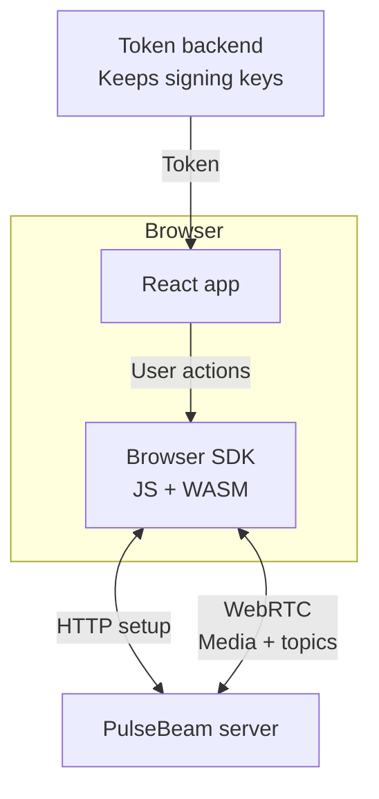

# React SDK concepts

Build a room where people can share camera, microphone, and messages.
The [quickstart](/react/quickstart) runs a complete app in two browser tabs.
You do not need to know WebRTC protocols to follow it.

Use this page to understand the parts you will work with. All SDK imports
come from `@pulsebeam/react`.

## What runs where?

Your backend decides who may join. React controls the UI and passes a token
to the SDK. The SDK connects to PulseBeam, which forwards media and messages
among participants in the room. HTTP sets up the connection; WebRTC carries
media and topic data. WebAssembly (WASM) is the SDK's compiled browser runtime.

For local development, the server's `--dev` profile and CLI provide tokens.
They replace the backend only for testing. Keep signing keys out of browser code.

## Join a room

A **room** groups participants who can exchange media and messages.
A participant token identifies both the room and the participant.

1. Give each simultaneous Agent a distinct participant credential in the same room.
2. Call `agent.connect()`.
3. Show successful entry only when `agent.getSnapshot().connection` is
   `"connected"`. Check the admitted identities too.

An **Agent** is one SDK session. Calling `connect()` means “try to connect,”
not “the server accepted me.” While that intent remains set, the runtime can
retry after temporary connection loss.

### Which identity should I use?

| Value | Use |
| --- | --- |
| `snapshot.participantExternalId` | Your admitted participant identity |
| `snapshot.roomExternalId` | Your admitted room identity |
| `remoteTrack.participantId` | The other participant's external identity |
| `snapshot.participantId` | An opaque internal ID, not your app's user ID |

The snapshot's external IDs are null before admission. They remain during
same-session reconnection and clear on disconnect. Do not use publication IDs,
receiver indices, or transport generations as app identities.

## Let React own the session

Use `useAgent(config)` in a mounted component. It can return null at first,
updates the component when snapshots change, and closes the Agent on unmount.
Agents start disconnected; capture does not start automatically.

| Change or action | Result |
| --- | --- |
| Update only the token | Renew authorization on the same Agent |
| Change endpoint, topology, or logging | Replace the Agent |
| `disconnect()` | Stop connection intent and retries |
| `reconnect()` | Request reconnection while keeping desired media and topic state |
| Unmount the owning component | Close the Agent |

**Topology** is the fixed number of sending and receiving slots reserved for
the Agent. It does not grow when you mount more videos. Use
[`createAgent`](/react/reference#createagent) only when you need to manage
subscriptions and cleanup yourself.

## Capture, publish, or stop?

**Capture** reads the camera or microphone. A **publication** makes a source
available to other participants. They have separate lifetimes.

After a user clicks a button, call `capture.request()` on a
`useUserMedia({video: true, audio: true})` result. To publish its video, pass
`capture.videoTrack` to `agent.local.video("camera").setSource(...)`.

The local handle is a stable reference named by your app. Repeated lookup
with the same kind and label returns the same handle. Labels such as
`camera`, `microphone`, and `screen` keep their slots for the Agent's lifetime.

| Goal | Action | Camera/microphone stays active? |
| --- | --- | --- |
| Send black video or silent audio | `handle.setEnabled(false)` | Yes |
| Remove the publication | `handle.setSource(null)` | Yes |
| Release the device | `capture.stop()` and clear/update bound sources | No |
| Leave the room | `agent.disconnect()` | Yes, unless you also stop capture |
| Unmount the capture hook | Hook cleanup | No |

The capture hook owns the native tracks. An Agent only borrows its sources.
Disconnecting or closing an Agent does not stop those tracks. Sender clones
keep one Agent's enablement separate from another's when they share capture.

See [pre-join preview](/react/guides#pre-join-preview) and
[enablement, withdrawal, and release](/react/guides#enablement-withdrawal-and-release).

## Receive video and audio

Use `agent.remote.videoTracks` and `audioTracks` to find remote publications;
these collections exclude yourself. Finding a publication does not prove it
is playing.

- **Video:** render `<Video source={track} />` at a visible, nonzero size.
  The SDK uses its size to request video. Hidden or off-screen elements do not
  reserve receivers; unmounting releases the request.
- **Audio:** the runtime selects and plays remote audio automatically.
  You do not need an audio component. If the browser blocks playback, call
  `agent.remote.resumeAudio()` directly from a click handler.

A remote handle stays stable across departure and republication. If you know
the participant and label, `remote.participant(externalId).video(label)`
works even before discovery.

For diagnostics, **Mapping** means the SDK assigned a publication to a
receiver. An audio track's `receiving` reports this assignment, not whether
the user can hear sound. See [missing media](/react/troubleshooting#missing-media).

## Send app messages

A **topic** is a named stream of JSON messages, such as `chat`.
Use `agent.topic<T>("chat", {mode: "reliable"})` to publish and subscribe.
Creating a topic alone does not subscribe.

Topics are not a durable message store. Both modes use bounded queues;
neither promises offline replay or exactly-once processing. Start with the
[typed topics guide](/react/guides#typed-topics) for subscription cleanup
and recovery.

## Next step

[Run the quickstart](/react/quickstart), then choose a task from the
[integration guides](/react/guides). Use the [API reference](/react/reference)
for exact contracts and [troubleshooting](/react/troubleshooting) when a step fails.
