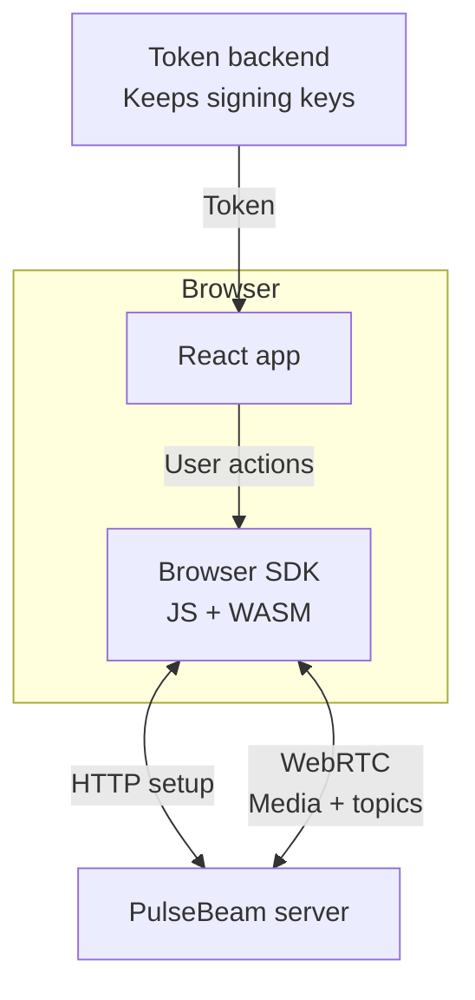

# React SDK

**See the other participant's video. Hear their microphone.**

Start with a working room in two browser tabs. No WebRTC knowledge needed.

**[Run the demo →](/react/quickstart)**

## How it works

A room connects participants. Each gets a token for that room and their own
identity. Your React app passes the token to the SDK; PulseBeam forwards the
participants' media and messages.

HTTP sets up the connection; WebRTC carries media and messages. The SDK runs
JavaScript and WebAssembly in the browser. Signing keys stay on your backend.

## Three things to understand

1. **The Agent is your session.** `useAgent(config)` creates it after mount
   and closes it on unmount. Call `connect()`; show success only when the
   snapshot says `connected`.
2. **Capture and publishing are separate.** `useUserMedia` owns the devices;
   `agent.local.video("camera")` borrows the captured source to publish it.
   A label identifies a stable handle, not a new track on every render.
3. **Video needs a visible view.** `<Video source={track} />` requests remote
   video at its displayed size. Remote audio plays automatically, subject to
   browser autoplay rules.

| You want to… | Do this |
| --- | --- |
| Mute camera or microphone | `handle.setEnabled(false)`; capture stays active |
| Stop publishing | `handle.setSource(null)`; capture stays active |
| Release the devices | `capture.stop()` or unmount its hook |
| Leave the room | `agent.disconnect()`; stop capture separately |

Use admitted external IDs for app identities, not opaque internal IDs.
The Agent reserves fixed media capacity at creation; mounting more views
cannot grow it. See [configuration and snapshots](/react/reference).

## Build the next thing

- [Add screen sharing, device controls, or messages](/react/guides)
- [Look up an API](/react/reference)
- [Fix a failing step](/react/troubleshooting)
