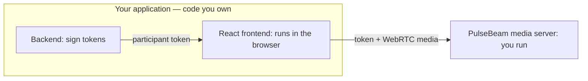

# Add video and audio to React

You build **your application's backend** and **React frontend**. PulseBeam
provides the media server, which you run separately.



Works with Next.js, Vite, Astro + React, or your existing React app.

## 1. Run the PulseBeam media server

With Docker (or Podman):

```sh
docker run --rm --network host ghcr.io/pulsebeamdev/pulsebeam:08eb663 --dev
```

The PulseBeam endpoint is `http://localhost:7070`.

::: warning Local development only
`--dev` uses public signing keys. Keep the server off public networks.
:::

## 2. Your app backend: issue a participant token

In **your application's backend** (Node.js), install the server SDK:

```sh
npm install @pulsebeam/server
```

```ts
import { signParticipantToken, INSECURE_DEV_CREDENTIALS } from "@pulsebeam/server";

function issueToken() {
  return signParticipantToken({
    projectId: INSECURE_DEV_CREDENTIALS.projectId,
    keyId: INSECURE_DEV_CREDENTIALS.keyId,
    secret: INSECURE_DEV_CREDENTIALS.secret,
    room: "demo",
    participant: crypto.randomUUID(),
    expiration: Math.floor(Date.now() / 1000) + 3600,
  });
}
```

Call `issueToken()` for each participant and send the resulting token to
your React frontend through your application's API or server-rendered props.
Never send the signing credentials to the browser. In production, authenticate
users and authorize room access before issuing tokens. For Rust, Go, or Python
backends, use the corresponding server SDK.

## 3. Your React frontend: connect

In **your React frontend** (running in your users' browsers), install the React SDK:

```sh
npm install @pulsebeam/react
```

In a browser-rendered React component, use the token from **your app backend**:

```tsx
const agent = useAgent({ endpoint: "http://localhost:7070", token });
```

Import `useAgent` from `@pulsebeam/react`; call `agent.connect()` on **Join**.
Your React frontend connects directly to the **PulseBeam media server**; your
app backend only supplies the token.

## 4. Your React frontend: share camera and microphone

```tsx
const media = useUserMedia({ video: true, audio: true });

useEffect(() => {
  if (!agent) return;
  agent.local.video("camera").setSource(media.videoTrack);
  agent.local.audio("microphone").setSource(media.audioTrack);
}, [agent, media.videoTrack, media.audioTrack]);
```

Import `useUserMedia` from `@pulsebeam/react` and `useEffect` from React.
Request capture in the Join click handler (not on mount):

```tsx
<button onClick={() => {
  agent?.connect();
  void media.request().catch(console.error);
}}>Join</button>
```

The labels `camera` and `microphone` name your publications.

## 5. Your React frontend: see the other participant

```tsx
{agent?.remote.videoTracks.map((track) => (
  <Video key={track.participantId + ":" + track.label} source={track} />
))}
```

Import `Video` from `@pulsebeam/react` and give it a visible, nonzero size.
Remote audio plays automatically when allowed; if blocked, call
`agent.remote.resumeAudio()` from a user click. On leave, call
`agent.disconnect()` and `media.stop()`.

Run your app and join from two tabs, each with its own token for the same room.
**Success means each tab receives video and audio from the other**, not just
a local preview. Use headphones to avoid feedback.

## Complete example

Explore the [complete React example](https://github.com/PulseBeamDev/pulsebeam/tree/main/apps/meet)
or see [capacity and configuration](/react/reference#configuration-types).

Next: [screen sharing and controls](/react/guides) ·
[API reference](/react/reference) · [Troubleshooting](/react/troubleshooting).
