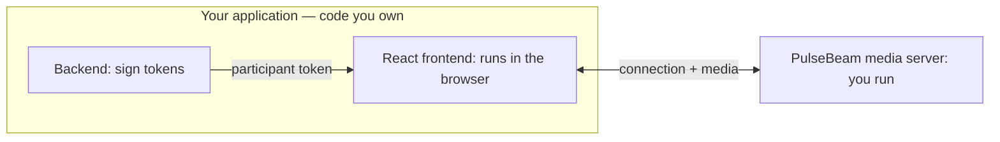

# Add video and audio to React

You own **your application's backend** and **React frontend**. PulseBeam
provides the separate media server, which you run.



Works with Next.js, Vite, Astro + React, or your existing React app.

## 1. Run the PulseBeam media server

With Docker (or Podman):

```sh
docker run --rm --network host ghcr.io/pulsebeamdev/pulsebeam:08eb663 --dev
```

The PulseBeam endpoint is `http://localhost:7070`.

::: warning Local development only
`--dev` trusts a fixed test key whose signing secret is publicly known.
Anyone can mint valid tokens for it. Never expose a `--dev` server publicly.
:::

## 2. Your app backend: issue a participant token

In **your application's backend** (Node.js), install the server SDK:

```sh
npm install @pulsebeam/server
```

`INSECURE_DEV_CREDENTIALS` provides the project ID, key ID, and signing secret
matching the server's `--dev` identity. That is why tokens signed below work
without configuring keys locally.

```ts
import { signParticipantToken, INSECURE_DEV_CREDENTIALS } from "@pulsebeam/server";

function issueToken() {
  return signParticipantToken({
    projectId: INSECURE_DEV_CREDENTIALS.projectId,
    keyId: INSECURE_DEV_CREDENTIALS.keyId,
    secret: INSECURE_DEV_CREDENTIALS.secret,
    room: "demo",
    participant: crypto.randomUUID(),
    expiration: Math.floor(Date.now() / 1000) + 3600,
  });
}
```

Call `issueToken()` for each participant and send the resulting token to
your React frontend through your application's API or server-rendered props.
Never send signing credentials to the browser. **In production:** run PulseBeam
without `--dev`, register your own public key with `--project-registry`, and
keep its matching private signing key on your application backend. Authenticate
users and authorize room access before issuing tokens.

For Rust, Go, or Python backends, use the corresponding server SDK.

## 3. Your React frontend: join the room

Install the React SDK in your app:

```sh
npm install @pulsebeam/react
```

Pass the token from **your application backend** into a `Room` component:

```tsx
import { useEffect } from "react";
import { Video, useAgent, useUserMedia } from "@pulsebeam/react";

export function Room({ token }: { token: string }) {
  const agent = useAgent({ endpoint: "http://localhost:7070", token });
  const media = useUserMedia({ video: true, audio: true });

  useEffect(() => {
    if (!agent) return;
    agent.local.video("camera").setSource(media.videoTrack);
    agent.local.audio("microphone").setSource(media.audioTrack);
  }, [agent, media.videoTrack, media.audioTrack]);

  function join() {
    if (!agent) return;
    agent.connect();
    void media.request().catch(console.error);
  }

  return (
    <main>
      <button disabled={!agent} onClick={join}>Join</button>
      <Video source={media.videoTrack} mirror
        style={{ width: 320, height: 240 }} />
      {agent?.remote.videoTracks.map((track) => (
        <Video key={`${track.participantId}:${track.label}`}
          source={track} style={{ width: 320, height: 240 }} />
      ))}
    </main>
  );
}
```

`useAgent` prepares a room session using the participant token. **Join** connects
to the PulseBeam media server and requests camera/microphone permission.
The effect publishes those tracks when capture starts; `Video` shows your
camera preview and other participants' video.

Only the **token** comes from your backend. WebRTC media goes directly between
the browser and PulseBeam. Remote audio plays automatically when allowed.

## 4. Try it

Start your React app and open it in two tabs. Give each tab a **different token**
for the same `demo` room, then click **Join** in both. Each tab should show
its own camera and the other participant's video and audio. Use headphones to
avoid feedback. For leaving, audio playback recovery, and error UI, see
[controls and audio](/react/guides).

## Complete example

Explore the [complete React example](https://github.com/PulseBeamDev/pulsebeam/tree/main/apps/meet)
or see [capacity and configuration](/react/reference#configuration-types).

Next: [screen sharing and controls](/react/guides) ·
[API reference](/react/reference) · [Troubleshooting](/react/troubleshooting).
