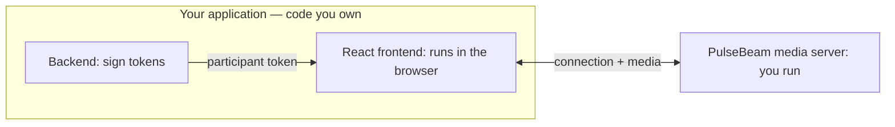

# Add video and audio to React

You own **your application's backend** and **React frontend**. PulseBeam
provides the separate media server, which you run.



Works with Next.js, Vite, Astro + React, or your existing React app.

## 1. Run the PulseBeam media server

With Docker (or Podman):

```sh
docker run --rm --network host ghcr.io/pulsebeamdev/pulsebeam:08eb663 --dev
```

The PulseBeam endpoint is `http://localhost:7070`.

::: warning Local development only
`--dev` uses public signing keys. Keep the server off public networks.
:::

## 2. Your app backend: issue a participant token

In **your application's backend** (Node.js), install the server SDK:

```sh
npm install @pulsebeam/server
```

```ts
import { signParticipantToken, INSECURE_DEV_CREDENTIALS } from "@pulsebeam/server";

function issueToken() {
  return signParticipantToken({
    projectId: INSECURE_DEV_CREDENTIALS.projectId,
    keyId: INSECURE_DEV_CREDENTIALS.keyId,
    secret: INSECURE_DEV_CREDENTIALS.secret,
    room: "demo",
    participant: crypto.randomUUID(),
    expiration: Math.floor(Date.now() / 1000) + 3600,
  });
}
```

Call `issueToken()` for each participant and send the resulting token to
your React frontend through your application's API or server-rendered props.
Never send the signing credentials to the browser. In production, authenticate
users and authorize room access before issuing tokens. For Rust, Go, or Python
backends, use the corresponding server SDK.

## 3. Your React frontend: join and share media

In **your React application** (browser code), install the React SDK:

```sh
npm install @pulsebeam/react
```

Render a `Room` component with the participant `token` received from **your
application backend**:

```tsx
import { useEffect } from "react";
import { Video, useAgent, useUserMedia } from "@pulsebeam/react";

export function Room({ token }: { token: string }) {
  const agent = useAgent({ endpoint: "http://localhost:7070", token });
  const capture = useUserMedia({ video: true, audio: true });

  useEffect(() => {
    if (!agent) return;
    agent.local.video("camera").setSource(capture.videoTrack);
    agent.local.audio("microphone").setSource(capture.audioTrack);
  }, [agent, capture.videoTrack, capture.audioTrack]);

  function join() {
    if (!agent) return;
    agent.connect();
    void capture.request().catch(console.error);
  }

  function leave() {
    agent?.disconnect();
    capture.stop();
  }

  return (
    <main>
      <button disabled={!agent} onClick={join}>Join</button>
      <button onClick={leave}>Leave</button>
      <button disabled={!agent} onClick={() => {
        void agent?.remote.resumeAudio().catch(console.error);
      }}>Enable audio</button>

      <Video source={capture.videoTrack} mirror
        style={{ width: 320, height: 240 }} />
      {agent?.remote.videoTracks.map((track) => (
        <Video key={`${track.participantId}:${track.label}`}
          source={track} style={{ width: 320, height: 240 }} />
      ))}
      {capture.error && <p role="alert">{capture.error.message}</p>}
    </main>
  );
}
```

The React SDK connects **directly to the PulseBeam media server**. Your backend
only issues the token; it never carries the WebRTC media.

## 4. Try it

Start your React app and open it in two tabs. Give each tab a **different token**
for the same `demo` room, then click **Join** in both. Each tab should show
its own camera and the other participant's video and audio. If the browser
blocks audio playback, click **Enable audio**. Use headphones to avoid feedback.

## Complete example

Explore the [complete React example](https://github.com/PulseBeamDev/pulsebeam/tree/main/apps/meet)
or see [capacity and configuration](/react/reference#configuration-types).

Next: [screen sharing and controls](/react/guides) ·
[API reference](/react/reference) · [Troubleshooting](/react/troubleshooting).
