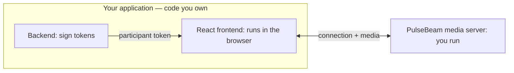

# Add video and audio to React

You own **your application's backend** and **React frontend**. PulseBeam
provides the separate media server, which you run.



Works with Next.js, Vite, Astro + React, or your existing React app.

## 1. Run the PulseBeam media server

With Docker (or Podman):

```sh
docker run --rm --network host ghcr.io/pulsebeamdev/pulsebeam:08eb663 --dev
```

The PulseBeam endpoint is `http://localhost:7070`.

::: warning Local development only
`--dev` trusts a fixed test key whose signing secret is publicly known.
Anyone can mint valid tokens for it. Never expose a `--dev` server publicly.
:::

## 2. Your app backend: issue a participant token

In **your application's backend** (Node.js), install the server SDK:

```sh
npm install @pulsebeam/server
```

`INSECURE_DEV_API_KEY` is a publicly known development-only API key matching
the server's `--dev` identity. In production, generate your own opaque API key,
store it according to your backend's secret-management policy, and pass it
explicitly to the server SDK. Never interpret or expose the key itself.

```ts
import { signParticipantToken, INSECURE_DEV_API_KEY } from "@pulsebeam/server";

function issueToken(participant: string) {
  return signParticipantToken({
    apiKey: INSECURE_DEV_API_KEY,
    room: "demo",
    participant,
    expiration: Math.floor(Date.now() / 1000) + 3600,
  });
}
```

Call `issueToken(participantId)` for each stable application participant ID and send the resulting token to
your React frontend through your application's API or server-rendered props.
Never send signing credentials to the browser. **In production:** run PulseBeam
without `--dev`, generate credentials with `./bazel run //:cli -- key`. The
command prints a private API key and public key-registry JSON. Store the API key
according to your backend's secret-management policy, pass it explicitly to the
server SDK, and place the public JSON at `key-registry.json` in the PulseBeam
server's working directory. Authenticate
users and authorize room access before issuing tokens.

For Rust, Go, or Python backends, use the corresponding server SDK.

## 3. Your React frontend: capture and join

Install the React SDK in your application:

```sh
npm install @pulsebeam/react
```

**Capture and the Agent are independent.** The parent owns the camera and
microphone; the keyed room owns the PulseBeam session. Pass in a token from
your application's backend.

```tsx
import {
  Video, useAgent, useUserMedia, type CaptureResult,
} from "@pulsebeam/react";

export function Call({ sessionId, token }: { sessionId: string; token: string }) {
  const media = useUserMedia({ video: true, audio: true });

  async function enableDevices() {
    try {
      await media.request();
    } catch {
      // useUserMedia exposes the failure through media.error.
    }
  }

  return (
    <>
      <button onClick={enableDevices}>Enable camera & mic</button>
      {media.error && <p role="alert">{media.error.message}</p>}
      <Video source={media.video} mirror style={{ width: 320, height: 240 }} />
      <Room key={sessionId} token={token} media={media} />
    </>
  );
}

function Room({ token, media }: { token: string; media: CaptureResult }) {
  const agent = useAgent({ endpoint: "http://localhost:7070", token });

  const Camera = agent.local.video("camera");
  const Microphone = agent.local.audio("microphone");

  return (
    <>
      <Camera source={media.video} />
      <Microphone source={media.audio} />
      <button onClick={() => agent.connect()}>Join room</button>
      <button onClick={() => agent.disconnect()}>Leave room</button>
      <p>Connection: {agent.connection}</p>
      {agent.error && (
        <p role="alert">{agent.error.message}</p>
      )}
      {agent.remote.videoTracks.map((track) => (
        <Video
          key={`${track.participantId}:${track.label}`}
          source={track}
          style={{ width: 320, height: 240 }}
        />
      ))}
    </>
  );
}
```

Committed JSX owns publications, including source changes and withdrawal on
unmount. No synchronization effect is needed. `connect()` records connection
intent; the Agent handles transient retries. Terminal failures require an
explicit retry after correcting the cause. The browser sends media directly to PulseBeam, not through your
application backend. To switch rooms or participants, change `sessionId`
(the React key); refreshing a token for the same session preserves its Agent.

## 4. Try it

Open your app in two tabs with different participant tokens for the same
`demo` room. Enable devices and join in both tabs. Each should display the
other's video and play remote audio. Use headphones to avoid feedback.

## Complete example

Explore the [complete React example](https://github.com/PulseBeamDev/pulsebeam/tree/main/apps/meet)
or see [capacity and configuration](/react/reference#configuration-types).

Next: [screen sharing and controls](/react/guides) ·
[API reference](/react/reference) · [Troubleshooting](/react/troubleshooting).
