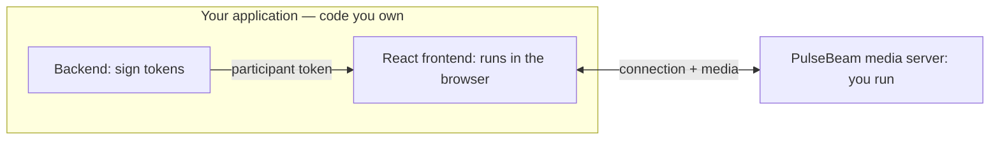

# Add video and audio to React

You own **your application's backend** and **React frontend**. PulseBeam
provides the separate media server, which you run.



Works with Next.js, Vite, Astro + React, or your existing React app.

::: warning Matching builds required
These examples describe the current source API. Compatibility with released
SDK packages and server images has not been qualified for this revision. Obtain
matching Web/React SDK archives and a server image from a trusted build before
following the example. Do not assume registry latest or an older image supports
owned publications, subscriptions and room watches.
:::

## 1. Run the PulseBeam media server

With Docker (or Podman), set `PULSEBEAM_SERVER_IMAGE` to your matching server
image. Use a current IANA `leap-seconds.list` from the host time zone data
package. Adjust the mount source if your package installs it elsewhere.

```sh
docker run --rm --network host \
  --mount type=bind,src=/usr/share/zoneinfo/leap-seconds.list,dst=/app/leap-seconds.list,readonly \
  "$PULSEBEAM_SERVER_IMAGE" --dev --utc-policy /app/leap-seconds.list
```

The PulseBeam endpoint is `http://localhost:7070`.

::: warning Local development only
`--dev` trusts a fixed test key whose signing secret is publicly known.
Anyone can mint valid tokens for it. Never expose a `--dev` server publicly.
:::

## 2. Your app backend: issue a participant token

In **your application's backend** (Node.js), install the server SDK:

```sh
npm install @pulsebeam/server
```

`INSECURE_DEV_API_KEY` is a publicly known development-only API key matching
the server's `--dev` identity. In production, generate your own opaque API key,
store it according to your backend's secret-management policy, and pass it
explicitly to the server SDK. Never interpret or expose the key itself.

```ts
import { signParticipantToken, INSECURE_DEV_API_KEY } from "@pulsebeam/server";

function issueToken(participant: string) {
  return signParticipantToken({
    apiKey: INSECURE_DEV_API_KEY,
    grants: [{ rooms: ["demo"], allow: ["join", "publish", "discover", "subscribe"] }],
    participant,
    expiration: Math.floor(Date.now() / 1000) + 3600,
  });
}
```

Call `issueToken(participantId)` for each stable application participant ID. Send
only the returned `token` to your React frontend through your application's API or
server-rendered props. Your backend can retain the returned `jti` for incident
correlation without logging the JWT.
Never send signing credentials to the browser. **In production:** run PulseBeam
without `--dev`, generate credentials with `./bazel run //:cli -- key`. The
command prints a private API key and public key-registry JSON. Store the API key
according to your backend's secret-management policy, pass it explicitly to the
server SDK, and place the public JSON at `key-registry.json` in the PulseBeam
server's working directory. Authenticate
users and authorize room access before issuing tokens.

For Rust, Go, or Python backends, use the corresponding server SDK.

## 3. Your React frontend: capture and join

Install the matching Web and React SDK archives in your application:

```sh
npm install /path/to/web-package.tgz /path/to/react-package.tgz
```

**Capture and the Agent are independent.** The parent owns the camera and
microphone; the keyed room owns the PulseBeam session. Pass in a token from
your application's backend.

```tsx
import { useState } from "react";
import {
  AgentStatus,
  Audio,
  usePublish,
  useSubscribe,
  Video,
  useAgent,
  useCapture,
  type Agent,
  type CaptureResult,
} from "@pulsebeam/react";

export function Call({
  sessionId,
  token,
}: {
  sessionId: string;
  token: string;
}) {
  const media = useCapture("device", { video: true, audio: true });

  return (
    <>
      <button onClick={() => void media.request().catch(() => {})}>
        Enable camera & mic
      </button>
      {media.error && <p role="alert">{media.error.message}</p>}
      <Video source={media.video} mirror style={{ width: 320, height: 240 }} />
      <Room key={sessionId} token={token} media={media} />
    </>
  );
}

function Room({ token, media }: { token: string; media: CaptureResult }) {
  const agent = useAgent({ endpoint: "http://localhost:7070", token });
  if (!agent) return <p role="status">Preparing session…</p>;
  return <ActiveRoom agent={agent} media={media} />;
}

function ActiveRoom({ agent, media }: { agent: Agent; media: CaptureResult }) {
  const state = agent.state();
  const [error, setError] = useState("");
  const [peer, setPeer] = useState("");
  const participant = peer ? agent.room("demo").participant(peer) : null;
  usePublish(agent.video("camera"), media.video);
  usePublish(agent.audio("microphone"), media.audio);
  const video = useSubscribe(participant?.video("camera") ?? null);
  const audio = useSubscribe(participant?.audio("microphone") ?? null);

  return (
    <>
      <Audio source={audio} />
      <button
        onClick={() => {
          try {
            agent.join("demo");
          } catch (failure) {
            setError(String(failure));
          }
        }}
      >
        Join room
      </button>
      {error && <p role="alert">{error}</p>}
      <p>Connection: {AgentStatus[state.status]}</p>
      {state.error && <p role="alert">{state.error.message}</p>}
      <label>
        Other participant ID
        <input value={peer} onChange={(event) => setPeer(event.target.value)} />
      </label>
      <Video source={video} style={{ width: 320, height: 240 }} />
    </>
  );
}
```

`useAgent()` returns `null` until its committed effect has initialized the Agent.
The mounted child uses the ready Agent without creating resources during render.
Committed JSX owns publications, including source changes and withdrawal on
unmount. `join("demo")` records explicit room intent; admission and transient
recovery remain asynchronous. Unmount `Room` to end the session. Calling
`agent.join(nextRoom)` changes rooms without replacing the Agent or stopping the
parent's capture. Change `sessionId` (the React key) for a different logical
session; refreshing a token for the same session preserves its Agent. The browser
sends media directly to PulseBeam, not through your application backend.

## 4. Try it

Open your app in two tabs with different participant tokens for the same
`demo` room. Enable devices and join in both tabs. Enter the other tab's
application participant ID, the value your backend used when issuing its token.
Each should display the other's video and play remote audio. Use headphones to avoid feedback.

## Add a roster when you need discovery

This example receives from an application-known participant ID; that requires
Subscribe, not Discover. To let users choose from room metadata, grant Discover
separately and use [one bounded `useWatch` page with explicit navigation](/react/guides#remote-discovery-and-video-receive-policy).
A watch includes presence-only participants, never starts reception and can close
without closing independent subscriptions. Do not replace known-address receive
paths with a global participant listing or an automatic all-page scan.

## Complete example

Explore the [complete React example](https://github.com/PulseBeamDev/pulsebeam/tree/main/apps/meet)
or see [capacity and configuration](/react/reference#capacity).

Next: [screen sharing and controls](/react/guides) ·
[API reference](/react/reference) · [Troubleshooting](/react/troubleshooting).
